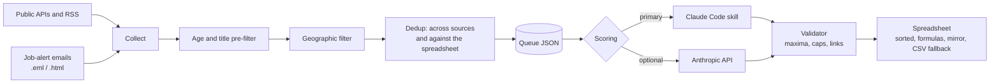

# Job Radar

**A lead-scoring pipeline where the leads are job ads.** It collects ads from public sources and from job-alert emails, filters and deduplicates them, then lets an LLM judge each one against a fixed rubric while deterministic code validates every number. The result is a sorted spreadsheet and one daily routine instead of ten browser tabs.

> Self-reported estimate: **from about 10-12 hours a week of manual searching to about 1 hour a week (roughly 90% less)**, including the time to read the shortlist.

I built it for my own job search in RevOps and GTM engineering. It is also a compact example of three things I care about in revenue operations: **heterogeneous data sources, deduplication and qualification rules, and AI in production with controls around it.**

## The idea in one table

| Job Radar step | Same problem in RevOps / GTM |
|---|---|
| Collect from public APIs, RSS feeds and alert emails | Enrichment from several providers |
| Deduplicate across sources and against history | CRM data hygiene |
| Geographic filter with great-circle distance | Territory and routing rules |
| Fixed six-criterion score | ICP fit scoring |
| Caps (language, UK-only, Ireland, US-only, unproven tool) | Knock-out / disqualification criteria |
| LLM proposes, validator disposes | AI in a workflow with deterministic guardrails |
| Daily run, spreadsheet with a safe fallback | Operational automation that survives a locked file |

## How it works



1. **Collect** (`jobradar/collect.py`). Public sources are read with an honest User-Agent, low volume and pauses. Each source is isolated: one failing source never stops the others.
2. **Filter.** Ads older than 30 days and off-track titles are dropped. Remote ads must be open to Europe; on-site and hybrid ads must be within a radius of home (great-circle distance on the city, never a list of countries).
3. **Deduplicate.** Same URL, or same company with a similar title (Jaccard on title tokens), across sources and against what the spreadsheet already holds. The source with the longest description wins.
4. **Score.** The queue is ordered by priority (local first, then the main lanes). A [Claude Code skill](skill/SKILL.md) (or the optional API path) reads each description and proposes six partial scores, with a rationale that names the main limit.
5. **Validate and write.** `jobradar/rubric.py` rejects any number outside its maximum, any cap that is not allowed and any bad link. `jobradar/excel.py` re-sorts everything by final score, rebuilds formulas and formatting, keeps the Status and Notes columns the user wrote, saves a mirror copy and compares hashes. If the file is locked in Excel it retries, then falls back to the mirror, then to a CSV.

## Results (my own runs, 20 November 2026)

| Metric | Value |
|---|---|
| Ads collected in one day, 7 sources | 2,808 |
| Filtered out before any LLM time (title, area, age, duplicates) | 2,473, each with a recorded reason |
| In the scoring queue | 335 |
| Scored with rationale, in three sessions | 180 |
| Of which in the high band | 0 (honest scoring: the best were 64-67, see design decisions) |

The spreadsheets are personal and not included. [`examples/jobs_example.xlsx`](examples/jobs_example.xlsx) is built from invented companies to show the format.

## Design decisions

- **The LLM judges, the code checks.** Scoring is a judgment call, so a model does it; but every number it writes is validated against `config/rubric.yaml` before it reaches the file. A model that returns `skills: 99` is rejected, not trusted.
- **Caps instead of ad-hoc subtraction.** A blocker (a required language the candidate does not speak, a UK-only remote role, a role built on a tool never used) caps the final score at 40, 45 or 60 whatever the rest scores. Subtracting 20 or 30 points would treat a 65 and a 55 differently for the same blocker, which makes no sense. Caps are explicit, auditable and few. Adding a rule is one edit in the YAML plus one `--override` run that re-scores the rows already in the file.
- **One rubric file, two consumers.** The same `rubric.yaml` builds the LLM prompt, the validator, the spreadsheet's Criteria sheet and the conditional formatting thresholds. Nothing drifts.
- **Mechanical work in code, judgment in the model.** Collection, geography, dedup, sorting and formulas are deterministic and tested. The model never touches the spreadsheet.
- **LinkedIn only through your own alert emails.** The pipeline never requests a LinkedIn page. An alert email you already receive is parsed locally for id, title, company and place (`jobradar/email_alerts.py`); such ads are scored on those fields only and the rationale says so.
- **Fail soft, say so.** A failing source is reported and skipped; a locked spreadsheet falls back to a mirror and then to a CSV; the summary states any difference between copies.
- **Honest scoring.** Over three scoring sessions on real data, no ad reached the high band. That is a feature: the rubric separates "interesting" from "apply tonight".

## Quick start

```bash
pip install -r requirements.txt
cp config/profile.example.yaml config/profile.yaml   # edit: this is who is searching
python -m pytest -q                                   # 61 tests, no network needed

python -m jobradar.excel create                       # once
python -m jobradar.collect --dry-run                  # counts only
python -m jobradar.collect                            # writes data/queue/queue-YYYY-MM-DD.json
```

Then score the queue in one of two ways:

- **Claude Code skill (primary).** Copy `skill/SKILL.md` into your skills folder or run it as a scheduled task. It reads the queue, scores with the rubric, writes `evaluations-YYYY-MM-DD.json` and runs `python -m jobradar.excel write`.
- **Anthropic API (optional).** Set `ANTHROPIC_API_KEY` (see `.env.example`), then
  `python -m jobradar.scoring_api --queue data/queue/queue-YYYY-MM-DD.json --limit 20 --out data/evaluations.json`
  and `python -m jobradar.excel write --evaluations data/evaluations.json`.

To use LinkedIn alerts, save the alert emails as `.eml` (or the HTML body as `.html`) into `data/alerts/`.

## Configuration

| File | What it holds |
|---|---|
| `config/sources.yaml` | enabled sources, search keywords, home city and radii, city coordinates, spreadsheet paths |
| `config/rubric.yaml` | criteria and maxima, bands, allowed caps and the rules behind them |
| `config/profile.example.yaml` | a fictional candidate; copy to `profile.yaml` (git-ignored) for your own |

Only sources with a public API or RSS feed are enabled by default (We Work Remotely, Himalayas, Jobicy, Working Nomads). Three more are included but **disabled**: freehire (aggregator API), Randstad Italia and EU Data Jobs (HTML pages). Check each site's terms of use and robots.txt before enabling them.

## Known limits

- The alert-email parser is heuristic and tested on a synthetic sample (`examples/alert_sample.html`); alert layouts change, so expect to adjust it.
- Ads from alert emails and from EU Data Jobs have no description: they are scored on title, company and place, with lower confidence.
- Applicant counts are not available on aggregator sources.
- The rubric and profile encode one person's search. The structure is reusable; the numbers are an example.
- The great-circle distance is not travel time.
- The spreadsheet is a file, not a database: fine for one person's daily run.

## Responsible use

Personal, low-volume use. No automated applications, no messages, no collection of personal data about recruiters or candidates, no bypass of logins, CAPTCHAs or anti-bot measures. See [docs/compliance.md](docs/compliance.md).

## Repository map

```
jobradar/        collect.py, email_alerts.py, rubric.py, excel.py, scoring_api.py, etl/, sources/
config/          sources.yaml, rubric.yaml, profile.example.yaml
skill/SKILL.md   the scoring routine for Claude Code
examples/        synthetic queue, evaluations, alert email and spreadsheet
docs/            architecture, design decisions, compliance
tests/           61 tests
```

## License

MIT. The Randstad Italia search logic is adapted from the MIT-licensed `andreadorizza/ai-job-search-italy`.
